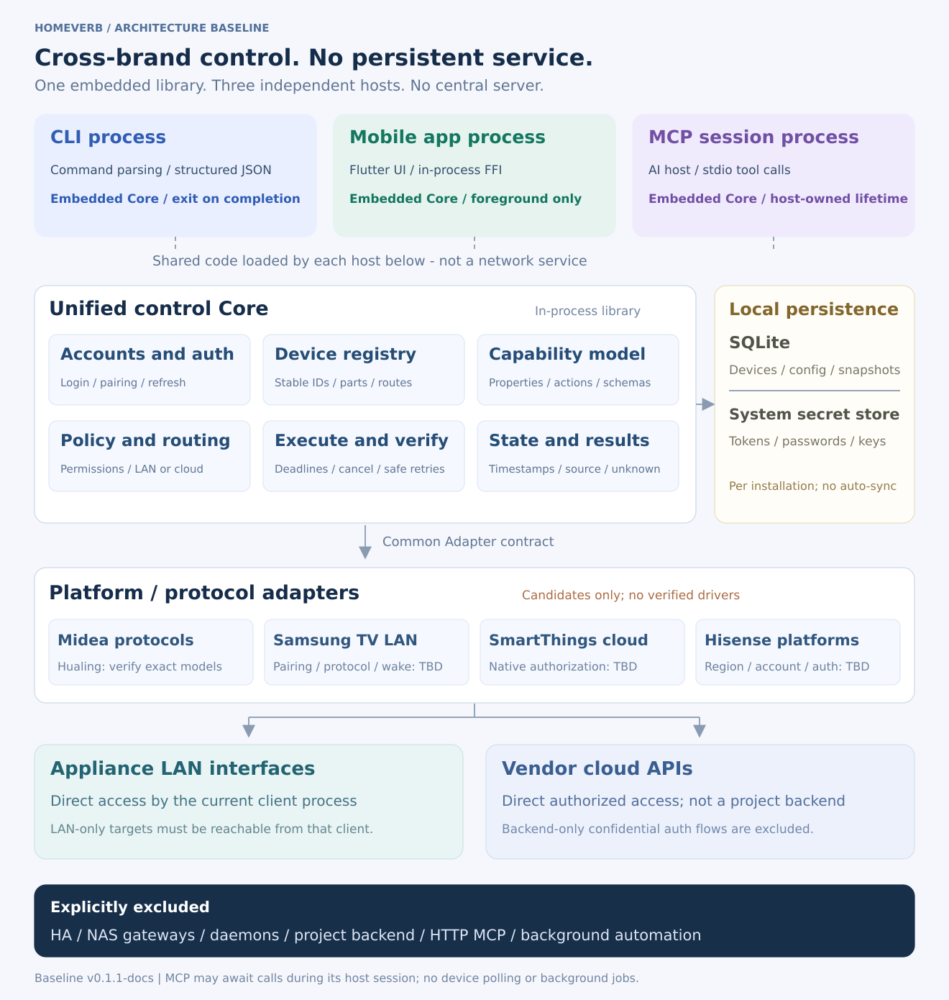
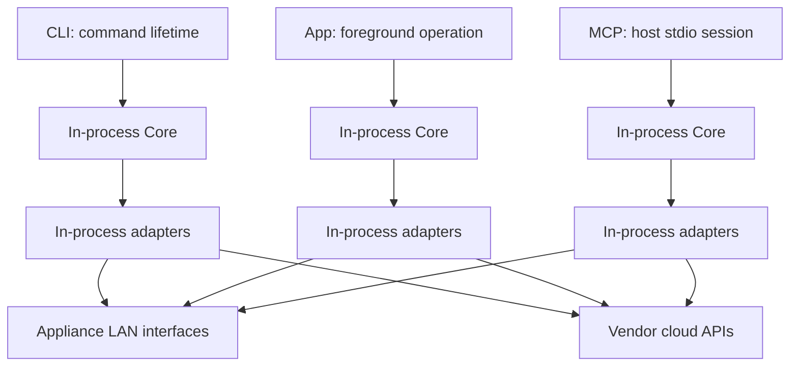

# System architecture

## Runtime view

One repository, one control library, three independent hosts. The CLI process, mobile process, and MCP child process each own their own Core instance. The shared box in the diagram represents code structure, not a node that all clients access over HTTP.

## Layers and dependency direction

| Module | Responsibility | Forbidden dependencies |
|---|---|---|
| CLI / Mobile / MCP | Input, interaction, output, trusted host identity | Vendor wire details; invoking and parsing another entry point |
| Application / Core | Validation, policy, routing, execution, verification | UI frameworks and MCP wire protocol |
| Domain / Schema | Devices, capabilities, commands, results, errors | Network libraries and database drivers |
| Adapter API | Platform contracts and extension points | A specific adapter implementation |
| Adapters | Authentication, pairing, protocols, capability mapping | Flutter UI and CLI presentation |
| Platform services | Local persistence, secret stores, clocks, network permissions | Brand-specific business decisions |

Core depends on interfaces. Hosts inject the adapter registry and platform services during startup. Storage paths, secret access, and the trusted principal come from the host, not arbitrary model-controlled tool arguments.

## Main operation flow

Start -> open local configuration -> resolve account and device -> validate capabilities and policy -> refresh authentication only if needed -> select a route -> execute -> optionally verify -> save the snapshot and outcome -> release resources.

Discovery and control have deadlines and cancellation tokens. Adapters cannot bypass Core by creating periodic workers. Subscriptions belong to explicit, bounded foreground tasks and must not outlive the host.

## Local persistence

SQLite stores configuration, device references, capability caches, timestamped observations, and bounded redacted execution records. Credentials live in the system secret store. Desktop CLI and MCP may share a store only for the same OS user and explicitly selected profile. Phone installations have independent storage and do not automatically synchronize. There is no central database.

Use short transactions, account-refresh locks, and per-device write coordination. Such locks only coordinate the local profile; they cannot prevent a vendor app or another computer from controlling the device concurrently.

## Implementation technology

Rust is implemented for Domain/Core/Adapter/CLI. The C ABI embeds the same Core in a native host; Linux loading, cancellation, and foreground gating are tested. Flutter is the owner-selected mobile framework. Android/iOS packaging, permissions, secure storage, and physical-phone lifecycle tests are still required. See the [UI integration guide](development/03-ui-integration.md).

The implementation uses reviewed compile-time registration and a fictional adapter. It does not depend on a Python device service. The stack and composite-receipt decision are recorded in [ADR-0007](adr/0007-mock-mvp.md).

## Decisions

[No daemon](adr/0001-no-daemon.md) | [Embedded core](adr/0002-embedded-core.md) | [Capability first](adr/0003-capability-first.md) | [Uncertain writes](adr/0004-uncertain-writes.md) | [Native authentication gate](adr/0005-native-auth.md)

Project and public identifier naming are defined in [ADR-0006](adr/0006-project-name.md).

[ADR-0008](adr/0008-foreground-authorization-sharing.md) permits explicit foreground local-network authorization transfer. The receiving installation subsequently operates independently; no shared control service or automatic synchronization is introduced.
