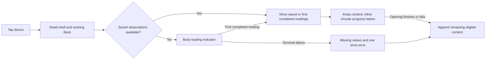

# HomeVerb interaction baseline

Status: owner-approved default for future App development, November 11, 2026.
Applies to home, search, rooms, every device family, accounts, sign-in, settings,
history and diagnostics, across providers and skins.

Keep pages simple, group related information, respond immediately to navigation,
reuse saved content and explain failures where they happen. Use the Mijia-inspired
interaction principles approved in the November 9 review without copying vendor
assets or implying additional device support.

## Authority and related specifications

This is the continuing interaction baseline. The
[November 9 handoff](../development/15-interaction-experience-handoff.md) supplies
UX-01 through UX-12 and the original milestone acceptance matrix. The November 10
staged-opening and local-visibility decisions and the November 11 unified power
glyph refine that handoff; their current behavior is included below.

For presentation conflicts, follow this baseline before older prototypes,
screen inventories and development proposals. In particular, do not restore
product artwork on home cards, folded device sections, routine device refresh
buttons, read-time footers or blocking navigation from an older screenshot.
Historical verification logs retain their original scope and results.

The [native UI contract](../native-ui-contract.md),
[execution contract](../routing-and-execution.md) and
[foreground lifecycle](../adr/0067-foreground-state-refresh.md) continue to govern
authority, consent, networking and receipts. This baseline changes none of them.
Use the [visual system](../ui-window-light.md) for theme tokens, the
[device design](../development/14-device-interaction-design.md) for control roles
and typography, and [feedback surfaces](feedback-surfaces.md) for shared feedback
components. Apply their details within the interaction rules here.

Routine implementation choices within this baseline need no new design approval.
When the owner changes the intended experience, update the affected rules and
acceptance checks together. Do not silently replace the baseline with a local
screen redesign or a provider-specific interaction convention.

## Navigation and staged loading

A device or account tap opens its destination immediately, with a stable title
and usable Back action. Do not wait on reads, inventory retrieval, grant
preparation, a pending card command or session replacement before navigating.
Native work must still serialize and drain safely inside the destination.

For device opening, use the following progression. The initial loader belongs
inside the detail body; it never covers navigation on the originating page.

Release the initial body loader when the first cached or live observation is
available; do not wait for every compartment or control preparation to finish.
Render completed groups promptly. Where a visible group still has unresolved
first readings, use value-local spinners. During the remainder of opening, an
inline circular indicator takes the place of Device information and Recent
Operations. Append these sections automatically when opening ends, including
terminal failure. This temporary loading stage is not a user-operated fold.

Preserve displayed readings and primary-card geometry during further reads and
control-session replacement. Reserve the power-row space; avoid briefly inserting
generic controls that preparation will replace. Do not restore a full-body loader
over existing content, add a fixed bottom progress bar, or delay completed content
for a cosmetic animation. Silent timer reads never show opening progress.

Track layout readiness, readings, control readiness and command progress
separately. A page-wide busy flag must not make navigation or unrelated content
unavailable. End progress on success, terminal failure, cancellation or lifecycle
invalidation; reject late results for another page, account, device or session.

## Readings, cache and weak networks

| Situation | Required presentation and behavior |
| --- | --- |
| First reading is unresolved | Loading indication at the current opening stage; never a fabricated reading |
| Successful read omits an optional numeric value | Show `—`; no failure Toast |
| First read fails without a previous completed snapshot | End loading, show `—`, and emit at most one short localized Toast for that opening attempt across all failing components |
| Some components succeed and others fail | Publish successful readings immediately; keep them when another component fails |
| Reopen with saved observations | Restore the correct device's reading groups before network completion; preserve the staged metadata behavior above |
| Automatic read fails | Keep previous readings, or `—` if none exist; no Toast, banner, spinner, retry burst or receipt change |
| User pulls to refresh home | Keep cards and context, show pull progress, publish completed items, and combine failures into one short error; no routine success Toast |
| History, diagnostics or account detail is loading | Show destination-local loading; show an empty state only after successful empty retrieval; failed retrieval offers its relevant recovery |

Numeric readings never display `Unknown`, `unknow`, `null`, `NaN`, an invented
zero, or a target substituted for a measurement. Unknown categorical codes use a
reviewed localized fallback; do not guess their meaning. Preserve actual values,
units, source timestamps and freshness in the underlying state. Saved readings
and the home-card power appearance are not proof of being online or authorized.

Reuse Core descriptors and observation caches plus local presentation preferences,
including restoration after process restart. Reconcile changed descriptors and
scope cached content by profile, account, device and component. Removal, relevant
cache cleanup and identity changes invalidate the affected views. Current grants
and observation prerequisites are checked independently; cached layout never
grants authority. Credentials and trusted approval previews do not belong in a
presentation cache.

## Refresh and lifecycle

Home uses pull, release and refreshing states, including short or empty lists.
Use `mobile.interactionReleaseToRefresh` in the canonical catalogs; its approved
Simplified Chinese translation is the release instruction, not a permanent button.
Keep a non-gesture accessibility action. Remove fixed home Refresh buttons and
routine device Refresh actions, last-read captions and measurement-time caveats.
An explicit recovery action for an uncertain command or account failure may
remain when it serves that specific condition.

Use the existing foreground three-second state-read policy in ADR-0067. Start a
fresh 3,000 ms interval after opening or other user work drains. Do not overlap
cycles, accumulate missed ticks, refresh inventory or prepare grants on the timer.
User work takes priority. Navigation out of eligible views and backgrounding stop
automatic reads; resume establishes a new eligible interval. No background service,
keep-alive, automatic write or uncertain-command replay is introduced.

## Home cards and organization

Use the approved outlined appliance icon family on all home, search and room
cards, including compact and enlarged-text variants in Window Light and Sky Blue.
Reuse the bundled/code-rendered icons; no product photographs, cutouts or runtime
icon downloads. Derive summaries from capabilities: AC target/mode, refrigerator
zone temperatures, cycle program/phase/time, or a suitable generic reading.
Keep setpoints distinct from measurements and provide a generic device icon.

In compact cards at ordinary text size, keep the room, summary and supporting
caption to one line each, with overflow ellipsis. A refrigerator's longer zone
caption must not add a second footer line and make it taller than peer cards.
Enlarged text may wrap and grow in the single-column layout; never cap text scale
or clip essential readings to force equal heights.

Card navigation, power and menu have separate hit targets. On and off use the
same power glyph, with the existing state colors, labels, accessibility semantics
and pending pulse. The approved missing-power appearance is off-looking; the
underlying observation remains null and cannot enable an otherwise denied action.
Do not restore a slashed-plug off icon or add an invented online badge.

The lower-right three-dot card menu contains two items in this order:
Assign room (`device.assignRoom`), then Remove device (`device.remove`).
Room assignment opens the existing R03 form with only that exact device and its
current room selected, without starting device reads or control preparation.
Cancel leaves the assignment unchanged. Remove device hides the card locally;
Platforms > account details lists associated devices with visibility checkboxes,
including hidden devices. Unchecking hides a card; checking it restores the card.
If every card is hidden, keep an entry to Platforms so restoration is reachable.
Persist visibility across restart and inventory refresh, and exclude hidden
devices from home/search/bulk selection and
visible-card reads. Hiding does not delete Core data, unbind the appliance or
change grants. Preserve filters, selection and scroll context through navigation.

## Expanded device content and controls

Every currently eligible device function, choice and information group is visible
by ordinary vertical scrolling after its loading stage. Do not require accordion,
More functions/programs/options/information or overflow-menu taps to reveal it.
Keep meaningful headings and spacing instead of collapsing content. Actual value
editing, room management, destructive confirmation and trusted command consent
may retain dedicated forms or sheets.

| Device family | Content order |
| --- | --- |
| Air conditioner | Power and target, measured room temperature, mode, fan, supported swing/directions, comfort/energy features, light/sound, then device information |
| Refrigerator | Zone name with distinct set/current readings, supported function groups, operating/door/reminder details, then device information; show a necessary read-only limitation once |
| Dishwasher and cycle devices | Observed program/phase/time, applicable actions and all supported program/options groups, supplies and reported settings, then device information; keep locked choices visible |
| Other or future devices | Primary observation/control, semantically grouped supported features, remaining readings and device information; retain a generic capability fallback |

For dishwasher presentation, keep program/phase/time readings separate from
supply warnings and reported settings. An unrecognized program uses the localized
Unknown fallback, without exposing raw codes or inventing a supported program.
This grouping does not add command mappings or establish physical-model support.

Read-only rows are plain label/value content. Single choices use radio/segmented
selection; independent combinations use checkboxes only when the descriptor
supports them. Boolean settings use switches only with known observations and
admitted actions; otherwise use explicit supported choices. Actions use clear
verbs. Obtain bounds, steps, enums, combinations and risk from the exact component
and current authority, never from a brand-wide template.

Observation prerequisites may withhold a control until its evidence exists;
reveal it automatically when eligible. A value editor or full capability form
must remain reachable when legal arguments cannot be expressed by inline controls.
Keep object and field schema support checks consistent. Compute decimal step
candidates accurately and use the same value for validation, permission checking
and submission. Core still validates every plan and command.

Commands show progress in the affected control/group and prevent duplicate taps.
Keep observed values until new observations arrive. Distinguish accepted, verified,
failed, unknown and partial outcomes; readback failure cannot turn accepted into
failed or verified. Unknown outcomes retain inspection/receipt recovery, never
automatic replay. Elevated actions still require actual trusted confirmation;
high-risk actions remain denied.

## Copy, feedback and accessibility

Prefer short, localized descriptions of what happened and what the user can do.
Keep raw provider responses, unreviewed codes and explanations about protocol
timestamps out of daily device reading rows. Use the canonical translation
catalogs and keep public IDs and command values stable.

Use `FeedbackToast` and its page-scoped queue for transient explicit-operation
feedback. Short Toasts fit their content and are horizontally centered; long ones
wrap with at least 24 logical pixels of side clearance. Never stretch a short
message into a full-width bar. Keep persistent, actionable conditions in
`FeedbackNotice`; do not duplicate the same error across multiple surfaces.
Preserve queue deduplication, navigation/background cleanup, accessible
announcements, extended screen-reader lifetime and reduced-motion behavior.

Center the sign-in Cancel label and its touch target in the form. Keep validation
near the relevant field, preserve recoverable nonsecret form input and prevent
duplicate submit. Protected sign-in fields and buffers still follow the existing
credential-clearing contract on dispatch, cancellation, navigation, backgrounding
and disposal; do not retain passwords as form-recovery state.

For the supported Meiju connection, successful sign-in remembers login inputs
only in system secret storage. A definite authorization failure on an inventory
or state read can trigger one bounded same-account automatic sign-in and one read
retry under [ADR-0076](../adr/0076-protected-account-auto-login.md). Accounts without
remembered inputs need one explicit sign-in through Manage account. Failed or
blocked recovery keeps that explicit path available; no background sign-in or
appliance-command replay follows. Remembered native credentials never repopulate
the password field or enter presentation preferences.

Account, organization and settings flows distinguish loading, empty, failed and
ready states. Retained settings entries must lead to a real supported action or
destination, with no decorative dead ends.

Use shared theme tokens and widgets across both skins. Maintain at least
48 logical-pixel interactive targets, native semantics and keyboard/Back behavior.
At 320, 390 and 430 logical pixel widths, support both locales, 200% text scale,
safe areas, keyboard insets and high contrast. Reflow content instead of clipping
it or capping text scale. Align controls and reserve stable loading geometry.

## Acceptance for future changes

Before implementation, identify the affected baseline sections and UX IDs. Reuse
the existing components and fictional fixtures. Validate only applicable scenarios,
then run the broader checks required by [testing](../testing.md) for the change.

| Gate | Observable evidence | Existing starting points in `apps/mobile/test/` |
| --- | --- | --- |
| Immediate and staged opening | Destination/Back available while a five-second read is held; first completed or cached group appears before remaining work; metadata appends without moving the primary card | `device_opening_test.dart`, `interaction_fencing_test.dart` |
| Loading, failure and cache | Terminal failures stop spinners; missing values are `—`; one initial failure Toast; correct cached groups survive reopen, partial failure and restart | `interaction_reading_test.dart`, `reading_states_test.dart`, `appliance_reading_states_test.dart` |
| Quiet scheduling | No periodic call at 2,999 ms and one eligible cycle at 3,000 ms; slow cycles do not overlap; ten failed cycles produce zero notices; background/navigation cancels | `state_refresh_test.dart`, `refresh_feedback_test.dart` |
| Cards and expanded controls | No product images or reveal taps; exact open/power/menu targets; all eligible descriptor choices reachable; hidden cards restore through account details | `device_cards_test.dart`, `compact_device_cards_test.dart`, `device_visibility_test.dart`, `dishwasher_interaction_test.dart` |
| Card organization and density | Assign room precedes Remove device; R03 preselects only the chosen card/current room without reads; account checkboxes restore hidden cards after restart; ordinary compact captions do not add a footer line | `device_visibility_test.dart`, `compact_device_cards_test.dart`, `organization_test.dart` |
| Safe editing and outcomes | Exact decimal candidate and grant; fallback form for unsupported inline schemas; invalid plan causes no execute; no duplicate or uncertain replay | `review4_decimal_test.dart`, `review4_fallback_test.dart`, `review5_root_fallback_test.dart`, `component_action_routing_test.dart`, `approval_test.dart` |
| Geometry and secondary flows | Cancel and short Toast center error at most one logical pixel; long Toast wraps; real empty/error/recovery routes work | `feedback_test.dart`, `auth_experience_test.dart`, `account_feedback_test.dart`, `organization_test.dart` |

For visual changes, inspect actual production Flutter captures with fictional
data, the production fonts, both skins/locales and the relevant size/accessibility
matrix. Include loading, failure, cached reopen and pending states, and inspect
the whole scrollable page. The diagrams here and the original external HTML
preview are design references, not runtime or physical-device acceptance.

Record executed commands, results, skipped/blocked checks and remaining acceptance
in the relevant verification record. Existing failed checks are not passes.
Use [implementation evidence](../development/interaction-implementation-evidence.md),
[review fixes](../development/interaction-second-review.md) and the
[App verification log](../../apps/mobile/verification.md) to distinguish historical
results from the current revision. This baseline requires no new API, grant,
storage format, provider access or real-device operation.
