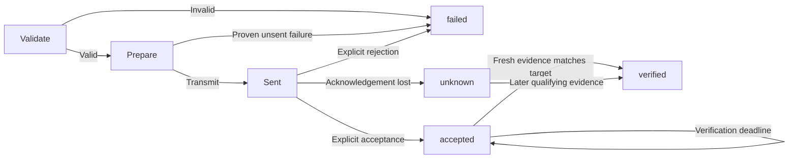

# Routing and execution semantics

## Route policy

`connection=lan` permits LAN only, with no cloud fallback. `cloud` permits vendor-cloud control only. `auto` chooses among action-supported routes with valid credentials, user permission, and current reachability; prefer LAN by default. A readable LAN route is not automatically writable for every action. Route by action, not merely by device.

Read/discovery operations may race safe routes within one shared budget. **Never race a write over LAN and cloud.** After an uncertain write on the primary route, do not duplicate it on a backup route.

Write routes must also satisfy the trusted grant for the complete command, including component and argument bounds. Explicitly requesting an ungranted route returns `POLICY_DENIED`. `auto` cannot use an ungranted route, even after a proven-unsent failure. Each non-atomic step must independently satisfy a complete grant and use only transports allowed for both parent and step. Dry-run performs this same preflight and returns per-step candidate transports. See [trusted policy](development/02-core.md) and [ADR-0010](adr/0010-scoped-write-grants.md).

## State machine

A later observation after `unknown` may prove that the target is now satisfied without proving this request caused it. Record `verification.kind=state_match` and that limitation. Do not promise exactly-once execution without causal evidence. A pure action with no correlated completion receipt or observable state remains `accepted` or `unknown`.

## Outcomes

| Status | What it establishes | What it does not establish |
|---|---|---|
| accepted | The interface accepted the request | The appliance reached the target |
| verified | Fresh qualifying state or a correlated completion receipt | A universal exactly-once guarantee |
| failed | Explicit rejection or a proven-unsent failure | Non-execution inferred from a generic timeout |
| unknown | Execution may have occurred; confirmation is missing | Permission to replay on another route |
| partial | Batch or non-atomic sub-operations had different outcomes | Global rollback or complete success |

## Retry matrix

| Situation | Automatic retry |
|---|---|
| Read timeout | Allowed within attempt and time budgets |
| Write proven not transmitted | Rerouting allowed within policy |
| Unacknowledged `set_value` write | Verify first; retry only with sufficient protocol/idempotency guarantees |
| Unacknowledged start / toggle / increment | Never automatically replay |
| Accepted request whose verification times out | Keep `accepted`; do not resend |
| Permission, argument, or identity error | Do not retry or switch accounts |

A local `request_id` correlates records; it is not automatically a vendor idempotency key. No protocol-level deduplication means no exactly-once promise.

## Budgets, cancellation, and crashes

A timeout includes validation, local storage/lock work, connection, necessary session refresh, transmission, and verification. Do not reset it per attempt. Check cancellation and the monotonic deadline before polling adapter work, including after synchronous storage operations. The budget prevents new sends after expiry; synchronous SQLite work and final receipt persistence are not preemptible and may delay return. Interactive login uses a separate explicitly initiated budget. Unsent work can be cancelled safely. Cancelling a sent write stops client waiting, not the physical operation; retain `unknown` or known `accepted` as appropriate.

Persist a pending phase before transmission and update after acknowledgement. On restart, unresolved records permit a warning or explicit read-based verification, never automatic replay. There is no atomic transaction spanning local storage and the appliance.

## Composite and batch operations

Treat multi-field `climate.set` as atomic only when the adapter declares it so. Split and track sub-steps only with an explicit `independent_fields: true` declaration, which requires a non-atomic `set_value` action. Otherwise pass the complete argument object to the adapter; absence of atomicity is not evidence that options may become separate commands. Batches return per-device outcomes with bounded concurrency. Do not compensate or roll back automatically: that would perform more physical changes without a reliable transaction boundary.

`Core::execute_batch` accepts 1-32 complete commands for distinct exact device IDs. Every command, composite step, permitted route, and request record is preflighted before sending. Duplicate caller IDs or collisions with derived child IDs are refused. A preflight failure returns an error with no sends or new receipts. Later metadata changes, lock contention, or storage failures can still affect individual items; this is not atomic admission across processes.

Execution uses groups of at most four borrowed futures and returns results in input order. A failed or uncertain device does not prevent independent devices from running. Every group shares the host's original cancellation/deadline; each command's own budget may shorten its execution window. After cancellation or expiry, queued items still return unsent outcomes through the normal journal path. Synchronous validation and storage are not preemptible, so cleanup may outlast the network budget. There are no detached tasks or automatic retries.

Batch status equals the common item status when all items agree, otherwise `partial`. Evidence belongs to each device or composite child, never to a fabricated batch device. Only per-command receipts are persisted. A forced exit can leave later items unstarted and without records; inspect individual IDs and never automatically resubmit the batch. See [ADR-0017](adr/0017-bounded-device-batches.md).

## Implemented Mock behavior

Capability resolution includes the selected component. Shared definitions omit `component_id`; scoped definitions bind one exact component, and shared/scoped mixing of one capability ID is invalid. The same resolver supplies action parameters, risk/routes/verification policy, live and cached property constraints, and property freshness. A fridge grant cannot authorize its freezer. Both remain one physical device with one write lock and separate component snapshots. See [ADR-0018](adr/0018-component-capability-scopes.md).

Operational lookup checks device/capability schema versions and shapes, unique identities and references, unambiguous property names, and locally compilable action schemas. Invalid metadata returns `CAPABILITY_UNSUPPORTED` before reads, dry runs, journal reservation, or writes. Discovery validates its complete per-adapter response before saving any descriptors from that response; an invalid response leaves existing metadata intact. This validation gate does not make storage commits across multiple devices or adapters atomic. Rediscovery also compares the entire response against stored connection identities before saving. `DEVICE_IDENTITY_CONFLICT` prevents silent binding changes under an already granted device ID. SQLite repeats each comparison within its write transaction to catch concurrent changes; earlier saved devices remain saved if a later transaction fails. This guard does not change command execution outcomes or authorize route merging.

The experimental Meiju adapter additionally requires complete account inventory
retrieval and checks current plus historical protected appliance bindings across
all selected accounts before returning descriptors. Native account connect/refresh reuses
`Core::publish_discovery` for the same registered-adapter, whole-batch validation
without a second cloud inventory request; no public JSON imports descriptors. Partial inventory and ambiguous
cross-account identity publish no new descriptor batch. Only explicitly reviewed
exact model/family pairs expose read properties. Unknown models remain visible with
unsupported status and no actions. Every Meiju observation remains stale while its
source timestamp is unproven; it cannot verify a write. Construction, local queries
and cached reads do no account or network work.

The current Core attempts each permitted route at most once. Only a proven-unsent reachability failure allows the next write route. A possibly-sent write returns `unknown` immediately; an explicit later read does not silently rewrite its receipt. State-match verification performs one bounded live read. All live snapshots, including verification reads, must use schema 1.0, match the requested device/component, and have every observation sourced from the selected transport. A source observation cannot be later than its local receipt, and a live receipt cannot be in the future. Empty warning strings are invalid. The entire snapshot is checked before saving; a valid target field cannot hide malformed unrelated fields.

The live-read rule applies to `state_match`. For `correlated_completion`, Core instead uses successful completion evidence returned by the same bounded adapter execution. The adapter validates protocol correlation; Core requires an exact match of request, device, component, and selected connection IDs. Receipt time must be at or after attempt start and no later than the current clock. If available, trustworthy completion time must be between attempt start and receipt. Evidence is used only after acceptance and when the caller requests verification. Missing or invalid evidence keeps `accepted` with `VERIFICATION_PENDING`, without a state-read fallback or another send. An enqueue acknowledgement is never completion.

Completion verification does not update observed state. It remains evidence of that operation even if the appliance subsequently changes. Cancellation or deadline expiry while waiting retains previously marked acceptance. Core projects only method, transport, timestamps, and a fixed explanation, never raw provider tokens. Already acquired completion evidence survives subsequent journal errors; the persisted row may still be conservative. See [ADR-0016](adr/0016-correlated-completion.md).

Invalid ordinary reads return `INVALID_OBSERVATION`, retain the old cache, and do not fall back to another route. Invalid verification leaves a known acknowledgement as `accepted` with `VERIFICATION_PENDING`, with no replay or cache replacement. A valid but stale unrelated property does not invalidate fresh target evidence. Missing observations remain absent, and an empty valid snapshot cannot verify a target.

Every returned observation must resolve to one readable property of the requested component. Core validates its value against that property's type, enum, bounds, and step, including unrelated fields in a verification response. Unknown properties, unreadable properties, ambiguous definitions, and malformed property descriptors fail closed. Vendor names are matched as complete `capability.property` identifiers; dots in a vendor capability ID are preserved. The current property contract does not permit null values; omit missing readings. Cached values are checked against the currently stored descriptor without refreshing, coercing values, or rewriting the cache. A valid descriptor update can therefore make an older cached value invalid until an explicit fresh read succeeds.

State-match verification compares validated numeric values independently of their integer or floating representation: `25` and `25.0` match. It does not coerce strings or booleans, round to a property step, or apply an approximate tolerance. Mixed integer/float comparison checks exact integer bounds before conversion so distinct large integers cannot match through floating-point rounding. Cached observations keep the adapter's original representation; verified result data keeps the requested arguments. This comparison does not change command equality for request-ID replay protection: changing a recorded argument from `25` to `25.0` still conflicts with that request ID.

Live reads, cached reads, and verification apply each property's `max_age_ms`, measured from `observed_at` when known and otherwise `received_at`. Omission retains the 30000 ms Mock baseline. Age at or above the limit is stale. Existing stale flags remain true; warnings explain property expiry, previous flags, or clock changes. Invalid limits fail descriptor admission before reads or writes. Limits need real-adapter evidence and are not a universal freshness promise; see [ADR-0015](adr/0015-property-freshness.md). Verification additionally requires target observations and receipt times at or after transmission. Cached reads recheck version, identity, and chronology without network fallback. A future cached receipt may reflect a local clock rollback: preserve it as stale with a warning instead of pretending it was just observed. Cached sources remain historical evidence even when the caller supplies a route preference. Cache reads do not rewrite persisted observations.

Non-atomic multi-field commands with `independent_fields: true` must validate as individual single-field commands before any send. Omitted or false retains all arguments in one adapter call per permitted attempt. Conflicting `atomic` or `idempotency` declarations return `CAPABILITY_UNSUPPORTED` before operational use. See [ADR-0012](adr/0012-explicit-action-decomposition.md). Their receipts contain `items` for both success and failure. All verified items produce `verified`, all accepted items produce `accepted`, all failed items produce `failed`, and different outcomes produce `partial`. Completed fields are not rolled back. The aggregate verification summary refers to the separate item evidence. See [ADR-0007](adr/0007-mock-mvp.md).

Exact receipt lookup is also available without invoking the write path: `Core::execution`, CLI `execution`, native `get_execution`, and MCP `execution_get` return a retained receipt unchanged. They do not require current write authorization or operational device metadata and do not read state, lock the device, or alter the journal. Missing/retired IDs give `REQUEST_NOT_FOUND` / `REQUEST_RETIRED`, never permission to resend. A later observation remains separate from the saved outcome; see [ADR-0014](adr/0014-local-receipt-lookup.md).

An identical request ID and command returns the saved receipt without sending, including after restart. A different command under the same ID fails with `REQUEST_CONFLICT`. When detailed receipts are retired, their IDs remain reserved; any reuse fails with `REQUEST_RETIRED` before transmission. The old outcome cannot be inferred from this error. See [retention and migration](storage.md).

Caller-supplied command identifiers are nonblank and bounded to 256 UTF-8 bytes. Composite steps validate each argument set and grant using the already valid caller ID before appending `:<step-index>` for internal receipt correlation. This preserves the full caller limit for composite commands; derived child IDs may be longer and must not be submitted as new standalone requests. Parent replay protection and child-ID collision checks still apply. Device locks also support the full accepted device-ID length through the bounded filename mapping in the storage contract.

Database failure before transmission prevents sending. Infrastructure failures after acceptance or verification preserve the strongest known outcome. A failed snapshot save cannot erase already obtained verification evidence. For a composite, any storage failure stops later writes and records remaining items as `failed` / `NOT_EXECUTED`, with no attempts. Parent and child receipts retain known results even if final persistence fails. Verified, unknown, or partial receipts record infrastructure errors in `warnings`; their existing evidence, uncertainty, and item results remain intact. An existing rejection, cancellation, or skipped-item error is also preserved, with the subsequent storage error added as a warning. A failed journal update may leave an earlier conservative stored outcome. Never replay or compensate to repair local storage.

CLI and native sessions pass their existing operation into Core. Starting execution never extends the earlier host deadline; a shorter command budget can only reduce it.
