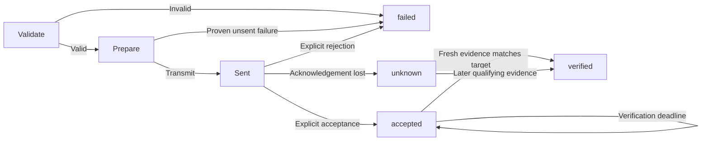

# Routing and execution semantics

API 1.24 routes account operations by registered provider and saved account ID
under [ADR-0073](adr/0073-mijia-native-account-routing.md). Combined sessions keep
one Core policy with exact Meiju grants and read-only Mijia admission. Positive
Mijia partial inventory publishes cards with explicit partial status. Ordinary
requests cannot change provider registration or authority. Device execution and
uncertain-write semantics are unchanged.

The Flutter account flow now selects a registered provider for protected sign-in
and uses the saved provider for reauthorization. Unsupported control-option
inspection does not prevent read-only device views; it supplies no grants. Mijia
primary appliance components precede auxiliary batteries so card summaries read
the appliance service. Unknown fields, raw lock codes and stale cloud evidence
retain their existing meaning; no Mijia write is added by this App phase.

## Experimental Mijia Core reads

[ADR-0072](adr/0072-mijia-protected-core-reads.md) adds a read-only cloud adapter
with protected account/model/component/connection checks before each property
request. Positive partial inventory can publish named cards through explicit
account connection/refresh. Generic discovery refuses populated Mijia accounts
before networking because it cannot represent partial coverage. Missing historical
bindings remain retained; no complete-inventory timestamp is invented.

Reads hold the account lease through one bounded cloud operation and correlate
every returned device/SIID/PIID. Snapshots carry cloud source, local receipt time,
no trustworthy observation time and stale values; Core still validates the entire
snapshot before replacing cache. Invalid replies preserve prior readings.
There is no automatic login, route fallback, background worker or control path.
Even forged public actions and Core grants cannot make this adapter send a write.
Native API, snapshot schemas and existing execution outcome semantics are unchanged.

## Mijia write protocol foundation

The low-level Rust protocol uses a separate progress-tracked, single-property
transport. Default/read transports refuse controls before sending. The first
possible send records `possibly_sent`; only an encrypted, exact single
DID/SIID/PIID acknowledgement can return accepted or explicitly rejected. Global
codes, malformed replies, cancellation and transport failures after send remain
uncertain. Accepted acknowledgements have no completion evidence. No retry,
reauthorization or route replay occurs. The Core adapter still denies writes;
this protocol addition does not change native schemas or create authority.

## Route policy

`connection=lan` permits LAN only, with no cloud fallback. `cloud` permits vendor-cloud control only. `auto` chooses among action-supported routes with valid credentials, user permission, and current reachability; prefer LAN by default. A readable LAN route is not automatically writable for every action. Route by action, not merely by device.

Read/discovery operations may race safe routes within one shared budget. **Never race a write over LAN and cloud.** After an uncertain write on the primary route, do not duplicate it on a backup route.

The App-owned [foreground state timer](adr/0067-foreground-state-refresh.md) issues
new bounded reads using this same route policy. Its three-second ticks do not
overlap or enqueue retries. User operations cancel and drain automatic reads
before planning; backgrounding and navigation fence delayed replies. A silent
read failure preserves prior observations, while successful reads retain source
freshness evidence and never rewrite accepted/unknown receipts or replay a write.
Core/adapter execution semantics and request/response schemas are unchanged.

Write routes must also satisfy the trusted grant for the complete command, including component and argument bounds. Explicitly requesting an ungranted route returns `POLICY_DENIED`. `auto` cannot use an ungranted route, even after a proven-unsent failure. Each non-atomic step must independently satisfy a complete grant and use only transports allowed for both parent and step. Dry-run performs this same preflight and returns per-step candidate transports. See [trusted policy](development/02-core.md) and [ADR-0010](adr/0010-scoped-write-grants.md).

Native `inspect_session_grants` projects current local device/transport rules
without credentials, adapters or mutation. Saved actions can outlive their prior
session's grants; inspect current policy after reopening. Neither returned rules
nor control-option definitions replace the execution gates above. See
[ADR-0057](adr/0057-session-grant-inspection.md).

## Trusted native connection linking

[ADR-0052](adr/0052-trusted-connection-linking.md) adds typed Rust
`prepare_connection_link` / `confirm_connection_link` to Core and Session. This
local metadata operation appends one adapter-admitted route to an exact device,
anchored to an existing connection with identical adapter/account/identity
references. It cannot merge accounts, replace bindings or change capabilities.
Ordinary discovery still refuses connection-set changes.

Show the immutable descriptor, anchor, proposed connection and
`transport_grants()` before trusted user consent. These are existing potential
grants for the new transport, not new permission or physical compatibility.
The new route participates in automatic reads and may activate existing matching
write grants; all action, argument, risk and transport checks still apply.
Cloud-only authority cannot authorize LAN writes.

The preview expires after 60 monotonic seconds and is consumed on every confirm
attempt. Core checks its instance/generation, locks the device, revalidates the
effective descriptor and adapter evidence, then checks cancellation, deadline
and preview again before transactional storage admission. Background/close
invalidates previews and cancels active operations. Dropping a preview dismisses
it. Adapter validation is asynchronous within the inherited Operation;
confirmation caps its budget at preview expiry. An in-flight wait reaching that
cap returns `DEADLINE_EXCEEDED`. A commit already admitted is not rolled back by later cancellation; inspect
local state after interruption. No appliance request, retry or execution receipt
is generated. Mock/Meiju do not opt in; only synthetic tests exercise linking.
API 1.20 exposes separate trusted C prepare/confirm/discard functions under
[ADR-0061](adr/0061-native-connection-link-bridge.md). Ordinary JSON, CLI and MCP
still cannot link. The session retains at most eight previews; background/close
clears them. Confirmation consumes the ID before decoded request admission,
without broadening adapter evidence, grants or Core's transactional rules.

## Reviewed dishwasher cycle operations

[ADR-0055](adr/0055-profile-scoped-dishwasher-cycle-controls.md) admits separate
`pause_cycle`, `resume_cycle` and `cancel_cycle` actions only for reviewed protected
products with no centralized settings to preserve.
[ADR-0063](adr/0063-explicit-dishwasher-cycle-options.md) additionally admits product
760Y0026 with an explicit `additional` choice (0, 9, 10, 13 or 14). Its grant and
immutable preview bind that exact value; never infer it from cached state.
Omitted grant arguments mean exactly `{}` and grant no additional-option operation.
Each requires its own exact
cloud grant and trusted single-command confirmation, remains elevated and
non-idempotent, and independently checks the approval marker in the adapter.
Program-start permission and these three permissions do not imply one another.

Send one action-specific cloud payload with no implicit state read, settings copy,
program selection, retry, fallback or optimistic observation. Preserve accepted,
failed and unknown outcomes and request-ID replay protection. Pause/cancel are
protocol requests, not safe-door, completed-drain or physical rollback guarantees.
Optional raw `operator` observations retain cloud staleness; neither a returned
operator nor `work_status` proves command causality. All existing execution,
approval expiry and foreground lifecycle semantics remain in force.

## Trusted foreground LAN candidate scan

[ADR-0054](adr/0054-trusted-meiju-lan-candidate-scan.md) composes discovery and
protected reconciliation for one saved Meiju device through typed Rust Session
methods. The host selects an assigned interface and handles platform permission.
Preparation validates exact device/connection IDs and protected mainland account
membership without networking. Its immutable, non-cloneable preview exposes the
device/network, belongs to one Session/lifecycle generation and expires after
60 monotonic seconds. Actual trusted consent is required before consuming it.

Confirmation rechecks metadata, holds the account lease through one collector
invocation, and revalidates protected identity/membership and current metadata
before returning. The inherited budget is capped by preview expiry; the production
collector retains its five-second window and two fixed probes. Cancellation,
background, close and dropped futures release operation resources; background and
close also invalidate outstanding previews. There is no automatic rescan.

`LanScanOutcome` returns only the selected candidate or `NotObserved`, `Incomplete`
or `Ambiguous`. Native redacted/nonserializable hints establish no authenticated
endpoint, model, credential or route authority. This flow performs no cloud
request, token lookup, TCP/state query, connection mutation or write. Ordinary
JSON, C/JNI, CLI and MCP do not expose it. Mobile permission and consent integration
remain pending; no physical acceptance follows from fictional integration tests.

## State machine

A later observation after `unknown` may prove that the target is now satisfied without proving this request caused it. Record `verification.kind=state_match` and that limitation. Do not promise exactly-once execution without causal evidence. A pure action with no correlated completion receipt or observable state remains `accepted` or `unknown`.

## Outcomes

| Status | What it establishes | What it does not establish |
|---|---|---|
| accepted | The interface accepted the request | The appliance reached the target |
| verified | Fresh qualifying state or a correlated completion receipt | A universal exactly-once guarantee |
| failed | Explicit rejection or a proven-unsent failure | Non-execution inferred from a generic timeout |
| unknown | Execution may have occurred; confirmation is missing | Permission to replay on another route |
| partial | Batch or non-atomic sub-operations had different outcomes | Global rollback or complete success |

## Retry matrix

| Situation | Automatic retry |
|---|---|
| Read timeout | Allowed within attempt and time budgets |
| Write proven not transmitted | Rerouting allowed within policy |
| Unacknowledged `set_value` write | Verify first; retry only with sufficient protocol/idempotency guarantees |
| Unacknowledged start / toggle / increment | Never automatically replay |
| Accepted request whose verification times out | Keep `accepted`; do not resend |
| Permission, argument, or identity error | Do not retry or switch accounts |

A local `request_id` correlates records; it is not automatically a vendor idempotency key. No protocol-level deduplication means no exactly-once promise.

## Budgets, cancellation, and crashes

A timeout includes validation, local storage/lock work, connection, necessary session refresh, transmission, and verification. Do not reset it per attempt. Check cancellation and the monotonic deadline before polling adapter work, including after synchronous storage operations. The budget prevents new sends after expiry; synchronous SQLite work and final receipt persistence are not preemptible and may delay return. Interactive login uses a separate explicitly initiated budget. Unsent work can be cancelled safely. Cancelling a sent write stops client waiting, not the physical operation; retain `unknown` or known `accepted` as appropriate.

Persist a pending phase before transmission and update after acknowledgement. On restart, unresolved records permit a warning or explicit read-based verification, never automatic replay. There is no atomic transaction spanning local storage and the appliance.

## Trusted single-command approval

[ADR-0042](adr/0042-trusted-single-command-approval.md) adds typed Core/Session
preparation and execution for one elevated action. Ordinary plan/execute remain
restricted to low-risk grants. Preparation does not send, journal, authenticate
or prove live preconditions. It requires a complete existing grant and one explicit
transport with exactly one admitted connection. The immutable preview expires
in 60 seconds; only the trusted UI may execute that same preview after consent.
No batch, independent-field decomposition, automatic routing or high-risk action
is admitted. No ordinary request field can supply approval.

Execution consumes the preview even on failure, revalidates descriptor/authority
and rejects a different Core, invalidated generation or expired preview before
send. Its budget is capped by the monotonic expiry. Existing device locks and
journaling prevent concurrent duplicate sends and preserve uncertainty on crashes.
A fixed receipt warning records that approval was supplied for the exact command.
The adapter receives Core's approval marker only on this path and must check it
before consequential effects, independently of cached risk metadata.

Native background/close invalidates pending previews and cancels in-flight work;
direct Rust hosts must implement the same lifecycle. Invalidation cannot undo a
sent command. Pending expiry/refusal stays unsent; expiry/cancellation after a
possible send stays unknown. Inspect the original request receipt rather than
creating an automatic retry. [ADR-0043](adr/0043-native-trusted-approval-bridge.md)
adds separate trusted C preparation/execution/dismissal functions. Session holds
at most eight pending previews and prunes expired entries during preparation.
A decoded execution consumes its matching ID before admission, including refusal;
malformed undecodable input does not. Missing/consumed/foreign/pruned IDs return
`APPROVAL_INVALID`; a retained expired preview returns `APPROVAL_EXPIRED`.
Background/close clears the registry; a generation check prevents publishing a
preview across a background/foreground race. No registry lock spans execution.
Ordinary JSON/CLI/MCP remain unchanged. Flutter consent UI has fictional native integration evidence; real-platform consent and physical acceptance remain separate work.
[ADR-0044](adr/0044-profile-scoped-dishwasher-start.md) uses this path for reviewed
experimental dishwasher starts: elevated, non-idempotent, exact arguments, one
cloud request, no replay/readback/optimistic cache. Explicit additional settings
are part of the confirmed command; stale cached state is never silently copied.

## Composite and batch operations

Treat multi-field `climate.set` as atomic only when the adapter declares it so. Split and track sub-steps only with an explicit `independent_fields: true` declaration, which requires a non-atomic `set_value` action. Otherwise pass the complete argument object to the adapter; absence of atomicity is not evidence that options may become separate commands. Batches return per-device outcomes with bounded concurrency. Do not compensate or roll back automatically: that would perform more physical changes without a reliable transaction boundary.

`Core::execute_batch` accepts 1-32 complete commands for distinct exact device IDs. Every command, composite step, permitted route, and request record is preflighted before sending. Duplicate caller IDs or collisions with derived child IDs are refused. A preflight failure returns an error with no sends or new receipts. Later metadata changes, lock contention, or storage failures can still affect individual items; this is not atomic admission across processes.

Execution uses groups of at most four borrowed futures and returns results in input order. A failed or uncertain device does not prevent independent devices from running. Every group shares the host's original cancellation/deadline; each command's own budget may shorten its execution window. After cancellation or expiry, queued items still return unsent outcomes through the normal journal path. Synchronous validation and storage are not preemptible, so cleanup may outlast the network budget. There are no detached tasks or automatic retries.

Batch status equals the common item status when all items agree, otherwise `partial`. Evidence belongs to each device or composite child, never to a fabricated batch device. Only per-command receipts are persisted. A forced exit can leave later items unstarted and without records; inspect individual IDs and never automatically resubmit the batch. See [ADR-0017](adr/0017-bounded-device-batches.md).

## Local account removal and late results

Local account removal under [ADR-0028](adr/0028-local-account-removal.md) preserves
execution receipts and retired IDs. It never rolls back or resends an appliance
action. Meiju retains its account lease through network work; cleanup refuses a
busy account. Receipts can still be finalized after the account lease is released,
even when cleanup has removed the device metadata. Their known outcomes remain
available through exact receipt lookup and global history.

SQLite rejects descriptor/snapshot saves referencing an account with removal
intent, including completed removal. Snapshot saves also require an existing
device. These checks share the write transaction, preventing late inventory or
read results from recreating cleaned data. They do not retract already delivered
results or make a multi-device publication atomic. A cache-save failure after
acceptance/verification follows the existing strongest-outcome preservation rules.

Under [ADR-0033](adr/0033-delete-unreadable-account-credentials.md), explicit account
removal deletes the exact protected entry without reading/decrypting it. A confirmed
absent entry causes no mutation; refused or uncertain deletion preserves pending
cleanup and metadata. This local idempotence does not permit retrying appliance writes.

## Explicit history clearing

[Local-data cleanup](adr/0029-local-cache-and-history-clearing.md) refuses history
clearing while any journal is active, including a composite parent. Completed
receipt details are retired atomically with their request IDs preserved. Clearing
a finalized unknown receipt does not resolve uncertainty or authorize a replay.
`REQUEST_RETIRED` still prevents sending after reopen. Cache clearing is independent:
it removes snapshots without cancelling or rolling back device operations, and a
concurrent read/verification may save new observations after the transaction.

## Implemented Mock behavior

Capability resolution includes the selected component. Shared definitions omit `component_id`; scoped definitions bind one exact component, and shared/scoped mixing of one capability ID is invalid. The same resolver supplies action parameters, risk/routes/verification policy, live and cached property constraints, and property freshness. A fridge grant cannot authorize its freezer. Both remain one physical device with one write lock and separate component snapshots. See [ADR-0018](adr/0018-component-capability-scopes.md).

Operational lookup checks device/capability schema versions and shapes, unique identities and references, unambiguous property names, and locally compilable action schemas. Invalid metadata returns `CAPABILITY_UNSUPPORTED` before reads, dry runs, journal reservation, or writes. Discovery validates its complete per-adapter response before saving any descriptors from that response; an invalid response leaves existing metadata intact. This validation gate does not make storage commits across multiple devices or adapters atomic. Rediscovery also compares the entire response against stored connection identities before saving. `DEVICE_IDENTITY_CONFLICT` prevents silent binding changes under an already granted device ID. SQLite repeats each comparison within its write transaction to catch concurrent changes; earlier saved devices remain saved if a later transaction fails. This guard does not change command execution outcomes or authorize route merging.

The experimental Meiju adapter additionally requires complete account inventory
retrieval and checks current plus historical protected appliance bindings across
all selected accounts before returning descriptors. Native account connect/refresh reuses
`Core::publish_discovery` for the same registered-adapter, whole-batch validation
without a second cloud inventory request; no public JSON imports descriptors. Partial inventory and ambiguous
cross-account identity publish no new descriptor batch. Only explicitly reviewed
exact model/family pairs expose read properties. Unknown models remain visible with
unsupported status and no actions. Every Meiju observation remains stale while its
source timestamp is unproven; it cannot verify a write. Construction, local queries
and cached reads do no account or network work.

An explicit trusted Meiju adapter opt-in additionally admits experimental AC
`power.set` for the four exact read models. Default hosts retain read-only adapters
and no Meiju write grants. Native API 1.3 can receive exact-device/state power grants
only from trusted startup under [ADR-0027](adr/0027-native-power-grants.md); ordinary
requests cannot change them. Control repeats the fixed argument contract and protected
account/device/connection/model checks before sending; public metadata cannot supply
a provider target. The separate HTTPS control path marks possible transmission
before executing the request. Only a valid code-zero envelope establishes acceptance;
HTTP 401/403 and recognized authorization codes establish rejection. Other provider
codes, malformed replies, HTTP failures and post-send cancellation remain unknown.
No retry, route fallback or automatic login follows. Verification is unavailable,
so accepted controls requested with `wait_for: verified` retain `VERIFICATION_PENDING`
without a state read or cache mutation. Existing Execution schemas and replay rules
apply unchanged; see the [control probe](development/07-meiju-control.md).

API 1.9 additionally admits a separately opted-in vendor AC fan action under
[ADR-0034](adr/0034-scoped-meiju-ac-fan-control.md). It shares the same transport,
protected model/binding checks and conservative outcomes, sending only one reviewed
`wind_speed` code. Power and fan permissions remain independent. It never changes
power, mode or temperature to force an effect; mode-dependent effectiveness remains
unverified. No read, optimistic cache update, fallback or retry follows acceptance.

API 1.11 adds explicit `vendor.midea.ac.activate_mode` under
[ADR-0039](adr/0039-explicit-meiju-mode-activation.md). Each independent startup
grant permits one exact device/mode and its combined power-on effect. The adapter
sends `power: on` and that mode in one request, never separate power/mode calls.
Neither power nor fan grants admit it. `atomic` and `independent_fields` are false;
accepted/unknown handling, protected checks and replay rules remain unchanged.
It neither copies cached status nor writes temperature/fan values. Model behavior
and preservation of unrelated settings remain unverified without physical evidence.

API 1.12 adds profile-scoped `climate.set {target_temperature}` under
[ADR-0041](adr/0041-profile-scoped-ac-temperature.md). After explicit discovery,
only admitted AC models with reviewed protected product evidence expose the action.
Its parameters carry the selected Celsius bounds and step; property observation
domains stay readable outside write limits. Authority names one device and exact
target. The adapter rechecks the protected selector and arguments before transport,
even when public descriptors were weakened. It sends only the selected temperature
field(s), without rounding, cached status, extra provider reads, optimistic cache
updates, replay or restoration. Missing evidence and explicit unsupported overrides
refuse before send. Atomicity/independent fields stay false; accepted/unknown
outcomes and physical-preservation limitations are unchanged.

The Linux CLI can supply these same independent grants through an explicit
owner-controlled file under [ADR-0037](adr/0037-cli-meiju-control-grants.md).
It requires explicit request IDs for single writes and previews, and never
refreshes capabilities implicitly before execution. Removing the file from a
later invocation revokes its permissions without erasing recorded receipts.
Default startup remains read-only; transport and outcome semantics are unchanged.

Under [ADR-0038](adr/0038-scoped-meiju-mcp.md), local Meiju MCP hosts can snapshot
the same grants at startup. Only those sessions expose `command_plan` and
`command_execute`; tool arguments cannot change authority. Commands retain their
explicit request IDs and budgets. RPC IDs identify cancellation/response messages,
not execution receipts. EOF/SIGINT and stdio failure cancel active work and drain
cleanup; lookup after restart preserves outcomes without replay. Removing a grant
file affects subsequent startup, not a currently running session.

The current Core attempts each permitted route at most once. Only a proven-unsent reachability failure allows the next write route. A possibly-sent write returns `unknown` immediately; an explicit later read does not silently rewrite its receipt. State-match verification performs one bounded live read. All live snapshots, including verification reads, must use schema 1.0, match the requested device/component, and have every observation sourced from the selected transport. A source observation cannot be later than its local receipt, and a live receipt cannot be in the future. Empty warning strings are invalid. The entire snapshot is checked before saving; a valid target field cannot hide malformed unrelated fields.

The live-read rule applies to `state_match`. For `correlated_completion`, Core instead uses successful completion evidence returned by the same bounded adapter execution. The adapter validates protocol correlation; Core requires an exact match of request, device, component, and selected connection IDs. Receipt time must be at or after attempt start and no later than the current clock. If available, trustworthy completion time must be between attempt start and receipt. Evidence is used only after acceptance and when the caller requests verification. Missing or invalid evidence keeps `accepted` with `VERIFICATION_PENDING`, without a state-read fallback or another send. An enqueue acknowledgement is never completion.

Completion verification does not update observed state. It remains evidence of that operation even if the appliance subsequently changes. Cancellation or deadline expiry while waiting retains previously marked acceptance. Core projects only method, transport, timestamps, and a fixed explanation, never raw provider tokens. Already acquired completion evidence survives subsequent journal errors; the persisted row may still be conservative. See [ADR-0016](adr/0016-correlated-completion.md).

Invalid ordinary reads return `INVALID_OBSERVATION`, retain the old cache, and do not fall back to another route. Invalid verification leaves a known acknowledgement as `accepted` with `VERIFICATION_PENDING`, with no replay or cache replacement. A valid but stale unrelated property does not invalidate fresh target evidence. Missing observations remain absent, and an empty valid snapshot cannot verify a target.

Every returned observation must resolve to one readable property of the requested component. Core validates its value against that property's type, enum, bounds, and step, including unrelated fields in a verification response. Unknown properties, unreadable properties, ambiguous definitions, and malformed property descriptors fail closed. Vendor names are matched as complete `capability.property` identifiers; dots in a vendor capability ID are preserved. The current property contract does not permit null values; omit missing readings. Cached values are checked against the currently stored descriptor without refreshing, coercing values, or rewriting the cache. A valid descriptor update can therefore make an older cached value invalid until an explicit fresh read succeeds.

State-match verification compares validated numeric values independently of their integer or floating representation: `25` and `25.0` match. It does not coerce strings or booleans, round to a property step, or apply an approximate tolerance. Mixed integer/float comparison checks exact integer bounds before conversion so distinct large integers cannot match through floating-point rounding. Cached observations keep the adapter's original representation; verified result data keeps the requested arguments. This comparison does not change command equality for request-ID replay protection: changing a recorded argument from `25` to `25.0` still conflicts with that request ID.

Live reads, cached reads, and verification apply each property's `max_age_ms`, measured from `observed_at` when known and otherwise `received_at`. Omission retains the 30000 ms Mock baseline. Age at or above the limit is stale. Existing stale flags remain true; warnings explain property expiry, previous flags, or clock changes. Invalid limits fail descriptor admission before reads or writes. Limits need real-adapter evidence and are not a universal freshness promise; see [ADR-0015](adr/0015-property-freshness.md). Verification additionally requires target observations and receipt times at or after transmission. Cached reads recheck version, identity, and chronology without network fallback. A future cached receipt may reflect a local clock rollback: preserve it as stale with a warning instead of pretending it was just observed. Cached sources remain historical evidence even when the caller supplies a route preference. Cache reads do not rewrite persisted observations.

Non-atomic multi-field commands with `independent_fields: true` must validate as individual single-field commands before any send. Omitted or false retains all arguments in one adapter call per permitted attempt. Conflicting `atomic` or `idempotency` declarations return `CAPABILITY_UNSUPPORTED` before operational use. See [ADR-0012](adr/0012-explicit-action-decomposition.md). Their receipts contain `items` for both success and failure. All verified items produce `verified`, all accepted items produce `accepted`, all failed items produce `failed`, and different outcomes produce `partial`. Completed fields are not rolled back. The aggregate verification summary refers to the separate item evidence. See [ADR-0007](adr/0007-mock-mvp.md).

Exact receipt lookup is also available without invoking the write path: `Core::execution`, CLI `execution`, native `get_execution`, and MCP `execution_get` return a retained receipt unchanged. They do not require current write authorization or operational device metadata and do not read state, lock the device, or alter the journal. Missing/retired IDs give `REQUEST_NOT_FOUND` / `REQUEST_RETIRED`, never permission to resend. A later observation remains separate from the saved outcome; see [ADR-0014](adr/0014-local-receipt-lookup.md).

An identical request ID and command returns the saved receipt without sending, including after restart. A different command under the same ID fails with `REQUEST_CONFLICT`. When detailed receipts are retired, their IDs remain reserved; any reuse fails with `REQUEST_RETIRED` before transmission. The old outcome cannot be inferred from this error. See [retention and migration](storage.md).

Caller-supplied command identifiers are nonblank and bounded to 256 UTF-8 bytes. Composite steps validate each argument set and grant using the already valid caller ID before appending `:<step-index>` for internal receipt correlation. This preserves the full caller limit for composite commands; derived child IDs may be longer and must not be submitted as new standalone requests. Parent replay protection and child-ID collision checks still apply. Device locks also support the full accepted device-ID length through the bounded filename mapping in the storage contract.

Database failure before transmission prevents sending. Infrastructure failures after acceptance or verification preserve the strongest known outcome. A failed snapshot save cannot erase already obtained verification evidence. For a composite, any storage failure stops later writes and records remaining items as `failed` / `NOT_EXECUTED`, with no attempts. Parent and child receipts retain known results even if final persistence fails. Verified, unknown, or partial receipts record infrastructure errors in `warnings`; their existing evidence, uncertainty, and item results remain intact. An existing rejection, cancellation, or skipped-item error is also preserved, with the subsequent storage error added as a warning. A failed journal update may leave an earlier conservative stored outcome. Never replay or compensate to repair local storage.

CLI and native sessions pass their existing operation into Core. Starting execution never extends the earlier host deadline; a shorter command budget can only reduce it.

## Meiju inventory membership admission

Under [ADR-0035](adr/0035-meiju-inventory-membership.md), each live bound read or
control checks protected membership while holding the account lease through the
network operation. A complete inventory marks missing historical bindings absent;
partial/failed retrieval preserves established membership. Identity records and
public descriptors remain retained. `MIDEA_DEVICE_NOT_LISTED` or
`MIDEA_INVENTORY_REQUIRED` fails before transmission without implicit enumeration,
login, fallback or retry. Reappearance preserves IDs and does not replay receipts.

Membership is never copied back from descriptors. Late publication cannot undo a
newer protected exclusion. Static plans and cached reads remain local and do not
check membership; execution can therefore refuse a previously valid plan. This
is last-retrieval evidence, not an online signal or current authorization proof.
No change is made to accepted/unknown writes, existing receipt lookup or journaling.

## Midea LAN candidate collection

The [bounded LAN collector](adr/0045-bounded-lan-discovery-decoding.md) uses the
caller's existing Operation and a selected private/link-local subnet. It sends
two fixed probes once, caps setup/collection at five seconds, and closes its
socket on completion, error, cancellation or future drop. Source filtering,
datagram/candidate limits and exact-tuple deduplication do not authenticate a
peer. A normal or limited report is not a complete inventory and must not remove
cards, merge identities, add routes or authorize TCP connections. CLI, native
JSON and MCP do not invoke this foundation yet. Public request/result schemas,
cloud routing and write outcome semantics remain unchanged.

The [V3 codec](adr/0046-bounded-v3-lan-codec.md) supplies only handshake and frame
processing. Key confirmation does not authenticate an advertised appliance ID or
authorize endpoint reuse. A valid response digest/sequence is not fresh state or
command acknowledgement. A future TCP adapter must retain identity, account
membership, operation lifetime, request correlation and write-progress checks;
codec success cannot change routing or replay an uncertain command.

The native `exchange_v3` helper now owns one socket for one inherited Operation.
It rejects invalid subnet endpoints/payloads and reused progress markers before
network access, then performs one handshake and command exchange with no retries.
Only the command write marks `possibly_sent`; connection/handshake failures leave
it unsent. Valid framing does not mark acceptance. Disconnects, cancellation,
deadline and future drop close the socket while preserving transmission evidence.
No adapter or entry point invokes this helper yet, so public schemas and cloud
write behavior remain unchanged; protected identity, grants and model evidence
still gate future route admission.

The [account-bound v2 credential helper](adr/0047-account-bound-lan-credentials.md)
uses an exact protected local binding and fresh unique cloud home membership.
It returns native handshake material without selecting or contacting a LAN peer.
No route, permission, inventory change or write outcome follows from a successful
lookup. Discovery hints cannot select provider IDs for it. A future registered
route must separately reconcile the endpoint and validate its model/permissions
before sending the token. Cloud failure does not trigger default keys, v1 lookup,
alternate UDP methods or automatic route fallback.

The [ordinary packet envelope codec](adr/0048-bounded-lan-packet-envelopes.md)
requires the expected native appliance ID and rejects mismatched wire identity
before exposing decrypted bytes. Its public checksum/key are forgeable. Valid
framing and matching identity fields do not establish endpoint ownership, an
inner model response, freshness or causal completion. The codec performs no I/O,
returns no outcome/observation and never changes existing transmission markers.
Model-aware validation remains necessary after `exchange_v3` releases its socket.

The [standard AC inner codec](adr/0049-ac-lan-query-and-c0-decoding.md) emits one
explicit query and decodes only query-kind C0 candidates. Strict AA framing and
checksum checks do not correlate an acknowledgement or establish freshness. Raw
mode/fan codes remain native protocol values; a model-aware adapter must admit
their semantics and reject known stale/alternate temperature layouts before
publishing observations. No default query, route, outcome or retry is added.

[Protected candidate reconciliation](adr/0050-protected-lan-candidate-reconciliation.md)
compares one exact saved account binding with a bounded report and explicit subnet.
It returns `NotObserved`, `Incomplete`, `Ambiguous` or a borrowed `UniqueCandidate`.
Conflicting target addresses/protocols/families and endpoint identity collisions
never choose a winner. Report limits prevent a unique result; no result changes
cards, membership, grants or connections. A unique hint is neither authenticated
nor globally unique and cannot authorize sending credentials or publishing state.
This native-only helper performs no networking and retains the caller's Operation.

The [composed AC V3 query](adr/0051-bounded-ac-lan-read-sequence.md) takes an already
admitted native endpoint, protected handshake and expected target. On one TCP
connection it queries the appliance's message version, then builds one AC query
with that version. Both replies require expected-ID envelope validation before
inner decoding. The injected clock supplies each packet's timestamp; neither
timestamp is observation evidence. One inherited deadline covers both reads;
errors, cancellation and drop close the connection without retry or fallback.
It returns C0 candidates only and never publishes a route, Snapshot or write
outcome. Existing one-command `exchange_v3` transmission phases are unchanged.

The standard E1/CA sequences in
[ADR-0053](adr/0053-dishwasher-refrigerator-lan-reads.md) reuse that same bounded
handshake/negotiation/query flow through `query_dishwasher_v3` and
`query_refrigerator_v3`. They validate the expected family/version at both stages
and return only native candidates. E1 retains raw program/status/temperature
codes; CA admits only its main-compartment Celsius prefix. Setter replies,
notifications, alternative headers, short bodies and unsupported units cannot
become observations or completion evidence. Model/endpoint admission and Core
route publication remain separate; no caller or grant is implicitly enabled.

## Trusted native scan bridge

[ADR-0058](adr/0058-native-lan-scan-bridge.md) exposes ADR-0054's typed scan through
three separate trusted C functions in API 1.18. Preparation stores at most eight
immutable device/network previews; confirmation consumes one before admission.
The controller must obtain assigned-interface information, platform permission
and actual foreground consent. Background/close clears previews and cancels work.
The original bounded operation, account lease and metadata checks still apply.
Only local IDs and a non-authoritative status leave the bridge; candidate
endpoints/provider identifiers are dropped. Ordinary JSON, CLI/MCP discovery,
cloud routing, storage and appliance write outcomes remain unchanged.

## Optional subtype in wall-AC temperature admission

[ADR-0066](adr/0066-optional-wall-ac-subtype.md) corrects an over-restrictive
selector: absent subtype is permitted only with an independently saved exact
reviewed wall model, explicit wall category and non-placeholder product code.
Existing product overrides and exclusions still determine the temperature encoding
and bounds. Execution rechecks the same protected evidence as option inspection
and discovery. No inferred subtype is stored; grants, schemas, one-send behavior,
accepted/unknown outcomes and the separation of later observations are unchanged.

## Optional AC prerequisite reads

[ADR-0069](adr/0069-profile-scoped-ac-features.md) adds independent profile-scoped
scalar setters. Core validates exact permissions and routing first; the adapter
rechecks protected membership/model/profile and its immutable argument schema,
then reads prerequisites within that same operation/deadline before its one
control send. Missing or unrecognized required state refuses before transmission.
Other supported swing axes must come from that operation, never Core cache.
A valid reported buzzer preference is preserved, an absent preference is omitted,
and a malformed report refuses before send. No upstream client default is copied.
These reads do not verify the later command or update Core's observation cache.
There is no atomic transaction with another vendor client; concurrent changes can
race the reads. Source-specific paired ECO fields stay in one request.

No retries or route fallback are added. A control request marked sent retains
possibly-sent/accepted evidence through timeout, cancellation and malformed reply;
only reviewed explicit rejections prove rejection. Reusing its request ID returns
the stored receipt without more prerequisite reads or sends. Separate foreground
state refresh remains observation evidence, never physical-causality proof.
