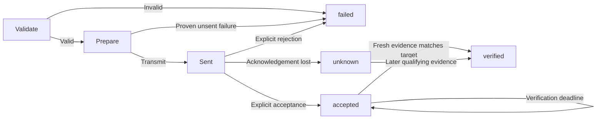

# Routing and execution semantics

## Route policy

`connection=lan` permits LAN only, with no cloud fallback. `cloud` permits vendor-cloud control only. `auto` chooses among action-supported routes with valid credentials, user permission, and current reachability; prefer LAN by default. A readable LAN route is not automatically writable for every action. Route by action, not merely by device.

Read/discovery operations may race safe routes within one shared budget. **Never race a write over LAN and cloud.** After an uncertain write on the primary route, do not duplicate it on a backup route.

## State machine

A later observation after `unknown` may prove that the target is now satisfied without proving this request caused it. Record `verification.kind=state_match` and that limitation. Do not promise exactly-once execution without causal evidence. A pure action with no correlated completion receipt or observable state remains `accepted` or `unknown`.

## Outcomes

| Status | What it establishes | What it does not establish |
|---|---|---|
| accepted | The interface accepted the request | The appliance reached the target |
| verified | Fresh qualifying state or a correlated completion receipt | A universal exactly-once guarantee |
| failed | Explicit rejection or a proven-unsent failure | Non-execution inferred from a generic timeout |
| unknown | Execution may have occurred; confirmation is missing | Permission to replay on another route |
| partial | Batch or non-atomic sub-operations had different outcomes | Global rollback or complete success |

## Retry matrix

| Situation | Automatic retry |
|---|---|
| Read timeout | Allowed within attempt and time budgets |
| Write proven not transmitted | Rerouting allowed within policy |
| Unacknowledged `set_value` write | Verify first; retry only with sufficient protocol/idempotency guarantees |
| Unacknowledged start / toggle / increment | Never automatically replay |
| Accepted request whose verification times out | Keep `accepted`; do not resend |
| Permission, argument, or identity error | Do not retry or switch accounts |

A local `request_id` correlates records; it is not automatically a vendor idempotency key. No protocol-level deduplication means no exactly-once promise.

## Budgets, cancellation, and crashes

A timeout includes connection, necessary session refresh, transmission, and verification. Do not reset it per attempt. Interactive login uses a separate explicitly initiated budget. Unsent work can be cancelled safely. Cancelling a sent write stops client waiting, not the physical operation; retain `unknown` or known `accepted` as appropriate.

Persist a pending phase before transmission and update after acknowledgement. On restart, unresolved records permit a warning or explicit read-based verification, never automatic replay. There is no atomic transaction spanning local storage and the appliance.

## Composite and batch operations

Treat multi-field `climate.set` as atomic only when the adapter declares it so. Otherwise track sub-steps. Batches return per-device outcomes with bounded concurrency. Do not compensate or roll back automatically: that would perform more physical changes without a reliable transaction boundary.
